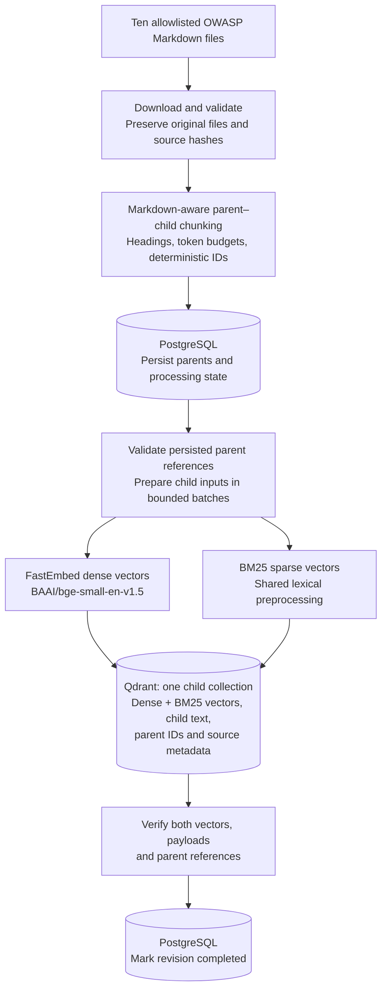
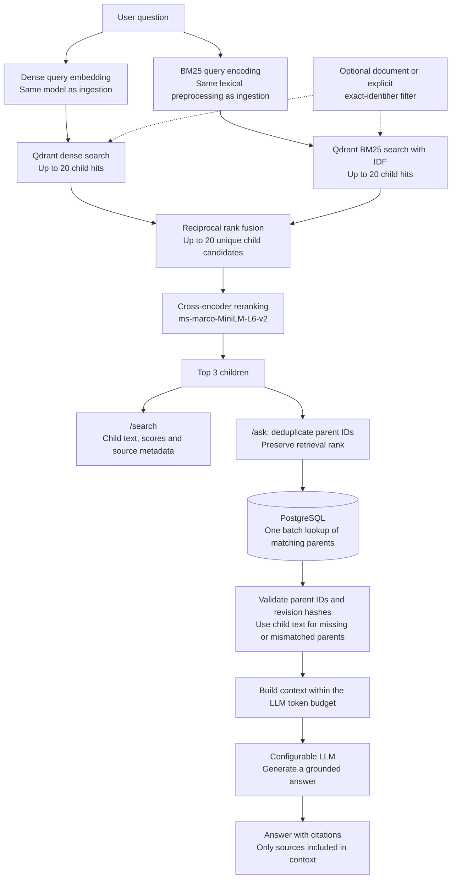

# AI Security Knowledge Assistant

A local RAG assistant that will answer LLM security questions using retrieved OWASP
documentation, dense + BM25 hybrid retrieval, and a configurable OpenAI-compatible
LLM. It uses local CPU embeddings, PostgreSQL for parents, and Qdrant for searchable
children.
Built with Python 3.12+, uv, and FastAPI.

## Status

Phases 1–4 are implemented: document downloading, Markdown-aware parent–child
chunking, persistent PostgreSQL parents and ingestion state, local CPU embeddings,
and initial Qdrant child indexing with both dense and BM25 sparse vectors.
Phase 5 will implement hybrid retrieval and `/search`. Document updates are deferred
to Phase 8; its flow will be discussed before implementation.
Answer generation (Phase 6) and evaluation (Phase 7) are also planned.

The implementation plan is in [specs/implementation-plan.md](specs/implementation-plan.md).

## Pipeline flow

### Ingestion

The offline pipeline processes one document at a time. Every child batch receives
both dense and BM25 vectors before storage. Parents are persisted before child writes.



Parents supply answer context; only children receive embeddings. PostgreSQL parent
writes precede Qdrant child writes, and incomplete ingestion remains retryable.

### Retrieval and answers

Phase 5 will implement hybrid retrieval and `/search`; Phase 6 will add parent
expansion and `/ask`. The cross-encoder reranks the fused candidates before either
response path.



## Development setup

Install Python 3.12+ and uv, then run:

```sh
uv sync
cp .env.example .env
uv run security-rag --help
uv run pytest
uv run ruff check .
uv run ruff format --check .
```

Run commands from the project root. Settings load from `.env`; environment variables
take precedence. Keep secrets in `.env`. LLM credentials are optional through Phase 5.

The settings in `.env.example` configure the download directory, per-request timeout,
retry count, Qdrant URL and collection, embedding model, and OpenAI-compatible LLM.
`DOWNLOAD_RETRIES` is the number of retries after the initial attempt (default 2,
maximum 5). `DOWNLOAD_TIMEOUT_SECONDS` must be positive (default 30).

## Local PostgreSQL and Qdrant

After copying `.env.example` to `.env`, set `POSTGRES_PASSWORD` to a local password
and set `DATABASE_URL` to `postgresql://security_rag:<password>@localhost:5432/security_rag`.
URL-encode special characters in the URL password. A generated hexadecimal password
avoids that encoding step. Keep both values in the ignored `.env`, out of Git.
`POSTGRES_USER` and `POSTGRES_DB` default to `security_rag`; keep the URL consistent
if you change them. PostgreSQL initialization settings apply when its volume is first created.

Start Docker, then run from the project root:

```sh
docker compose up -d --wait
curl --fail http://localhost:6333/readyz
uv run security-rag migrate
```

Compose uses PostgreSQL 17 and Qdrant 1.19.2. Both ports bind only to localhost
(PostgreSQL 5432, Qdrant HTTP 6333); both stores use persistent named volumes.
PostgreSQL has a readiness health check. The Qdrant dashboard is available at
[localhost:6333/dashboard](http://localhost:6333/dashboard).

`migrate` explicitly applies Alembic's versioned Python migrations in
`src/security_rag/parent_store/migrations/versions/` transactionally and records the
current revision in `alembic_version`. Repeating it is safe. Keep applied revisions
unchanged and add a new revision for subsequent schema changes. Migration definitions
are frozen separately from the application's current SQLAlchemy table definitions.
An existing database with the original `001_parent_storage.sql` checksum is adopted
without recreating tables or changing parent data; its historical `schema_migrations`
table is retained. Unknown or modified legacy migrations are rejected.
Importing the application and running other commands never migrate the schema.
PostgreSQL access uses SQLAlchemy Core expressions with the Psycopg 3 driver;
application queries and migrations contain no handwritten SQL. Pydantic chunk models
remain independent of persistence definitions. Each store owns a SQLAlchemy engine
with a pool bounded by `DATABASE_POOL_SIZE` (default 4, maximum 16), no overflow
connections, and connection health checks. `DATABASE_TIMEOUT_SECONDS` sets the pool
acquisition, connection establishment, and statement timeouts. Budget connections
across every worker and replica; each process has its own pool. Write operations use
explicit transactions, with connections released before embedding or Qdrant calls.

```sh
docker compose down
```

Stopping services preserves their named volumes. Downloading and previewing chunks
require neither database.

## Ingest documents

With PostgreSQL and Qdrant running:

```sh
uv run security-rag migrate
uv run security-rag download
uv run security-rag ingest
uv run security-rag stats
```

`ingest` is an explicit offline command; starting containers does not ingest data.
Keep the API stopped until ingestion finishes. The initial pipeline is:

1. Load and validate each local Markdown document.
2. Build bounded parents and children with deterministic IDs and revision hashes.
3. Persist parents and `processing` state in PostgreSQL.
4. Validate parent references for a bounded batch of children.
5. Generate dense vectors and BM25 sparse vectors for that same batch.
6. Write both representations and child metadata together in one Qdrant upsert.
7. Validate stored parents, payloads, and both vector representations, then mark the document complete.

Dense encoding uses CPU FastEmbed `BAAI/bge-small-en-v1.5`, initialized only when
needed and reused within the process. Its output has 384 dimensions; complete child
inputs are checked against the matching tokenizer without silent truncation.

BM25 encoding uses local FastEmbed `Qdrant/bm25`, with Qdrant applying IDF once.
The first ingestion measures average analyzed child length and freezes it in
PostgreSQL's `sparse_configuration`. It is reused on subsequent runs. Defaults are
`BM25_K=1.2`, `BM25_B=0.75`, and `BM25_TOKEN_MAX_LENGTH=512`. Model artifacts are
cached in the ignored `EMBEDDING_CACHE_DIR` (default `data/models`).

The pipeline always encodes and writes both vectors. It has no per-point sparse
existence check, dense-only write mode, sparse repair, or backfill command. Repeating
an unchanged input regenerates both vectors and upserts the same deterministic IDs,
so it does not create duplicate points. It retains `processing` state on a failed
write; a repeated run of that same input executes the complete dual-vector path.

Parents remain in PostgreSQL. Each Qdrant point contains the unnamed dense vector,
the named `bm25` sparse vector, child text, `parent_id`, source/revision metadata,
canonical `identifiers`, and `sparse_config_hash`. Parent text is not copied into
child payloads. A new collection defines both vector spaces from creation. Existing
collections must already have the expected dense and sparse schema; ingestion does
not migrate dense-only collections.

Lexical input combines the document code, unique title/heading path, and rendered
child body. Shared preprocessing lowercases input, disables stemming and stopwords,
preserves digits, and adds stable alphanumeric aliases for recognized punctuated
codes. Supported patterns include `LLM01`, `CWE-79`, `CVE-2026-12345`,
`ERR_CONNECTION_RESET`, and `0x80070005`. Exact identifier equality uses the
`identifiers` keyword index; BM25 supplies relevance ranking. `document_id` also
has a keyword index. Tokens longer than the configured character limit fail
explicitly instead of being silently dropped.

The sparse configuration hash includes the model/library version, analyzer/input
format, token limit, BM25 parameters, and frozen average. Changing a stored document,
its chunking configuration, or the frozen sparse configuration is currently rejected.
Replacement, obsolete-record removal, incremental skips, and repair are deferred to
Phase 8. We will discuss their flow before implementing it. Existing parent and
vector records are not deleted by this initial-ingestion command.

The command processes one document at a time with bounded batches
(`INGESTION_BATCH_SIZE`, default 32, maximum 256). JSON output reports processed and
failed document counts, parent/child counts, token ranges, dense/sparse encoding
durations, sparse nonzero terms/configuration, and persistence/indexing durations.
It exits nonzero if any document fails. PostgreSQL and Qdrant have no shared transaction;
completion is recorded only after stored records have been verified.

`stats` reads persisted state, the frozen sparse configuration, and collection counts
without loading models. `PostgresStore.resolve_parents()` fetches requested IDs in
one batch and excludes missing or mismatched revisions. Phase 6 will use this to
build answer context without loading the parent corpus into memory.

## Planned retrieval pipeline

Phase 5 will encode the question for dense semantic search and BM25 lexical search,
prefetch up to 20 children from each branch, and fuse their rankings with reciprocal
rank fusion (RRF). The union can contain up to 40 children; fusion will retain at most
20 for cross-encoder reranking, and `/search` will return the top three children.
Apply the same optional document or explicit exact-identifier filter to both branches
before their candidate limits. [Qdrant's Query API supports prefetch and RRF fusion](https://qdrant.tech/documentation/search/hybrid-queries/).

Dense retrieval covers semantic paraphrases; BM25 supplies lexical evidence for
specific keywords and codes present in the indexed content or metadata. RRF combines
ranks because dense and BM25 scores have different scales. Responses will distinguish
fusion scores from reranker scores; raw branch scores/ranks will be nullable unless
collected. Empty lexical matches can use an explicit `dense_only` mode; encoder/store
failures and incomplete sparse indexing will return an error. A reranker fallback
must be explicitly marked as degraded.

In Phase 6, `/ask` will deduplicate those children's parent IDs and fetch the matching
parents from PostgreSQL in one parameterized batch query. It will preserve the rank
of each parent's highest-ranked child, validate document/configuration revisions,
and build the generation context within the LLM's token budget. A request will load
at most three parents into memory with the selected Top-3 retrieval configuration.
The application will not load the parent corpus into memory at startup.

Missing or mismatched parent records will use the matching child text as fallback.
A PostgreSQL lookup failure will be logged and returned as a service-unavailable
response. Answers will cite only sources included in the generation context.

Phase 7 will compare dense-only, BM25-only, fused, and reranked results on the same
labeled questions, including code/keyword cases and semantic paraphrases. It will
measure candidate recall, final Recall@3/MRR@3, exact-code hit rate, context quality,
and stage timings. Synthetic error codes belong in isolated tests; retrieval cannot
supply error-code documentation absent from the OWASP corpus. The full defaults,
initial-ingestion acceptance criteria, and failure behavior are in the implementation plan.

## Download OWASP documents

```sh
uv run security-rag download
uv run security-rag download --refresh
```

The downloader fetches only the ten explicitly listed Markdown files from the
[canonical 2026 source directory](https://github.com/GenAI-Security-Project/GenAI-LLM-Top10/tree/main/2026/final).
It saves the original bytes under `data/owasp/` by default, without cloning the
repository or downloading an archive. Downloaded files are ignored by Git.

Existing files are validated and skipped by default. Use `--refresh` to replace
them. Requests have timeouts and bounded exponential retries for transport errors,
HTTP 408/429/5xx, and invalid response content. Other HTTP errors and redirects fail
immediately. Responses must be HTTP 200, have a Markdown/plain-text content type,
and contain nonempty UTF-8 Markdown with the expected document code, year, title,
and a body. Content length is checked when provided for an uncompressed response.

Each validated download is saved through a temporary file and an atomic replacement.
A failed refresh preserves that file's previous contents. The command exits with
status 1 on failure; already completed files remain available, so the command can be
rerun. Invalid existing files require `--refresh`.

Successful commands print JSON containing downloaded/skipped counts and metadata for
all ten documents: document ID, code, title, filename, version, local path, original
GitHub URL, and SHA-256 of the original bytes. Metadata is derived from the local files
each time, rather than stored in sidecar files. No Git commit SHA is recorded.

## Chunk local documents

After downloading the ten documents, run:

```sh
uv run security-rag chunk
```

The command loads the embedding model's tokenizer on demand. The first run may
download `tokenizer.json` from Hugging Face; it does not download embedding weights.
For offline use, set `TOKENIZER_PATH` to a local copy of the matching
`BAAI/bge-small-en-v1.5` tokenizer. `TOKENIZER_REVISION` selects the Hugging Face
revision when no local path is supplied. Tokenizer contents are included in the
configuration hash, so changed tokenizer artifacts create distinct chunk revisions.

ATX headings define section boundaries relative to the document title, including
titles at `##`. A source-position scanner preserves original whitespace, repeated
heading occurrences, introductory content, and heading-like lines inside fences.
Oversized units use LangChain's token-aware `RecursiveCharacterTextSplitter` with
`split_documents`; source slices, IDs, and parent relationships remain explicit.

Parents contain at most 1,200 tokens including heading context. Children contain at
most 450 tokens for the **complete embedding input**, including the document/section
prefix, restored table headers or code fences, and special tokens. Counting uses the
matching tokenizer with truncation and padding disabled. Fitting Markdown blocks
remain intact; oversized blocks split at natural boundaries, then token offsets.
Original text and source ranges remain separate from restored Markdown syntax.

Parents never overlap or combine unrelated sections. Only children from the same
oversized heading unit and parent can overlap, by up to 60 tokens; overlap shrinks
when required to fit. Every child carries a deterministic UUIDv5 `parent_id`.
Source, parent, child, and canonical configuration hashes distinguish revisions;
unchanged input reproduces the same identifiers.

The command prints JSON with document, parent, and child counts, maximum token
lengths, and hashes. Each document's `parent_chunks` lists parent IDs and texts with
their child IDs and texts nested under `children`.
Parents and children remain in memory in the per-document `ChunkedDocument`
returned by the chunker. The `chunk` command is a preview: it writes no chunk files
and does not access PostgreSQL or Qdrant. Use `ingest` to persist parents in
PostgreSQL and child vectors in Qdrant. Future answer generation will fetch matching
parents directly from PostgreSQL.

## Structure and tests

`config.py` owns settings. `ingestion/manifest.py` defines the source allowlist,
`ingestion/downloader.py` handles HTTP and safe persistence, and `ingestion/loader.py`
validates local Markdown and derives document metadata. The CLI coordinates these
operations. `ingestion/markdown.py` tracks Markdown structure and source positions;
`chunker.py`, `chunk_models.py`, and `tokenizer.py` implement bounded chunks, metadata,
and token counting. Importing the package does not download documents or initialize
models.

Unit tests use temporary directories and mocked HTTP responses; they need neither
network access nor Docker, model downloads, or LLM credentials. They cover settings,
metadata and hashing, the manifest, download skip/refresh behavior, retries, invalid/incomplete
downloads, preservation of existing files, and CLI success/failure behavior. Chunking
tests cover relative/repeated headings, introductions, long sections, lists, tables,
fences, Unicode, source ranges, overlap boundaries, hashes, deterministic IDs, parent
links, and validation without writing chunk files. Ingestion tests use an isolated
in-memory Qdrant collection and a transactional parent-store stand-in. They cover initial dual-vector writes, deterministic repeated writes, failed
encoding/persistence, invalid parent references, and rejection of document updates.

Run the optional acceptance checks with the real model tokenizer and local corpus:

```sh
TEST_TOKENIZER_PATH=/absolute/path/to/tokenizer.json uv run pytest -q
```

These checks verify complete-input budgets, source coverage, deterministic output,
and in-memory parent resolution for all ten files, plus oversized structured blocks.
They perform no network calls and are skipped without `TEST_TOKENIZER_PATH`; corpus
cases also require the downloaded Markdown files.

Run PostgreSQL integration tests against the local development database:

```sh
# Use the same local connection URL as DATABASE_URL (do not commit it).
TEST_DATABASE_URL='<local PostgreSQL URL>' uv run pytest -q tests/test_postgres_store.py
# Optional: include checks against a live Qdrant instance.
TEST_QDRANT_URL=http://localhost:6333 uv run pytest -q tests/test_qdrant_live.py
```

PostgreSQL tests create and remove a unique disposable schema for each case, leaving
application tables untouched. They verify migrations and rollback, legacy-schema
adoption, pool limits and statement timeouts, parent round trips, Markdown fields,
batched lookup from a fresh pool, ingestion-state persistence, and recovery after
partial initial child writes. Qdrant tests create and remove an isolated test
collection. Both integrations are opt-in; default unit tests require no services.
Set both `TEST_DATABASE_URL` and `TEST_QDRANT_URL` to include the dual-store sparse
acceptance test. It verifies initial dual-vector creation, sparse queries with exact identifier
filters, parent lookup after restart, and completion only after verification. BM25 unit tests exercise the actual FastEmbed analyzer and weights
without downloading its unused stopword artifacts.

## OWASP attribution

The downloaded documents are by the OWASP GenAI Security Project / OWASP Foundation,
from *OWASP Top 10 for Large Language Model Applications*, version 2026.
The [source repository](https://github.com/GenAI-Security-Project/GenAI-LLM-Top10#license)
licenses this material under [CC BY-SA 4.0](https://creativecommons.org/licenses/by-sa/4.0/).
The downloader makes no changes to the Markdown. Retain attribution and source/license
links when sharing it; indicate changes and apply the license's ShareAlike terms to
adapted OWASP material.

## Implementation checklist

- [x] Initialize the Python package, dependency lock, and development tooling.
- [x] Save the supplied implementation plan under `specs/`.
- [x] Phase 1: Settings, Docker Compose, document downloads, metadata, and tests.
- [x] Phase 2: Markdown-aware parent–child chunking and tokenizer validation.
- [x] Phase 3: PostgreSQL parent storage, local embeddings, and initial Qdrant child ingestion.
- [x] Phase 4: Dense and BM25 sparse vectors written together during initial ingestion.
- [ ] Phase 5: Dense + BM25 hybrid retrieval, RRF, reranking, and Top-3 search API.
- [ ] Phase 6: Grounded answers and source citations.
- [ ] Phase 7: Evaluation dataset, metrics, tests, and documentation.
- [ ] Phase 8: Document updates for PostgreSQL parents and Qdrant children; design discussion first.

Implementation will follow the plan's package structure as each capability is
added. OWASP content must retain its attribution and comply with its source license.
